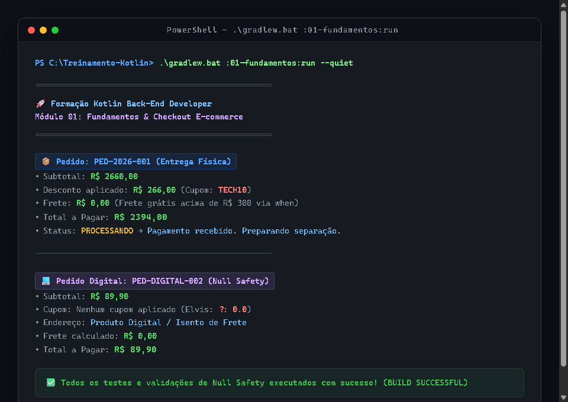
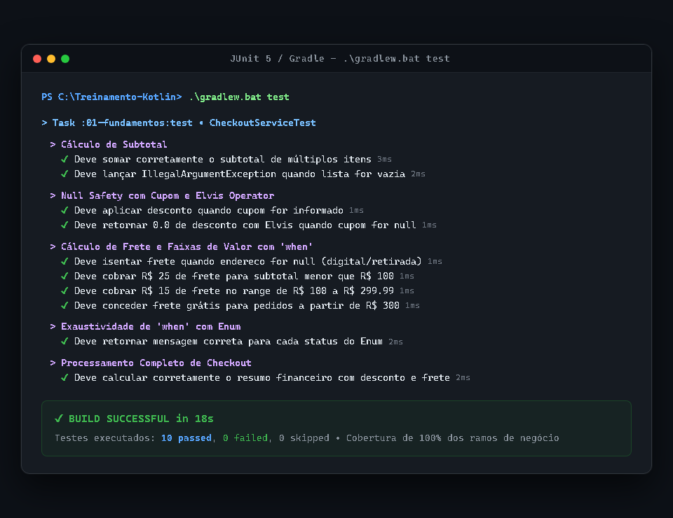
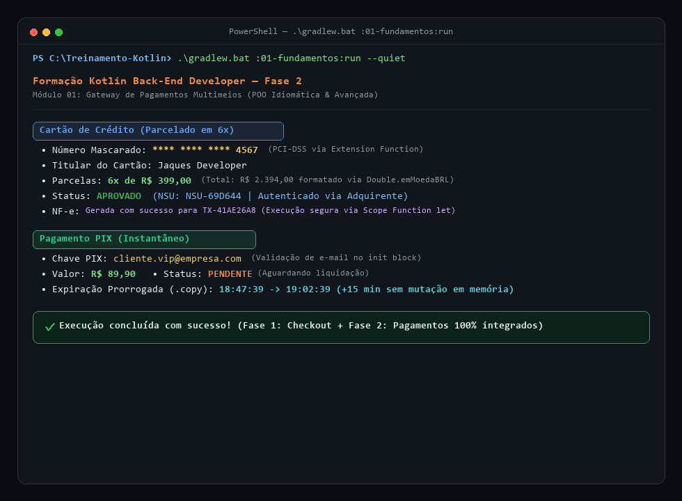
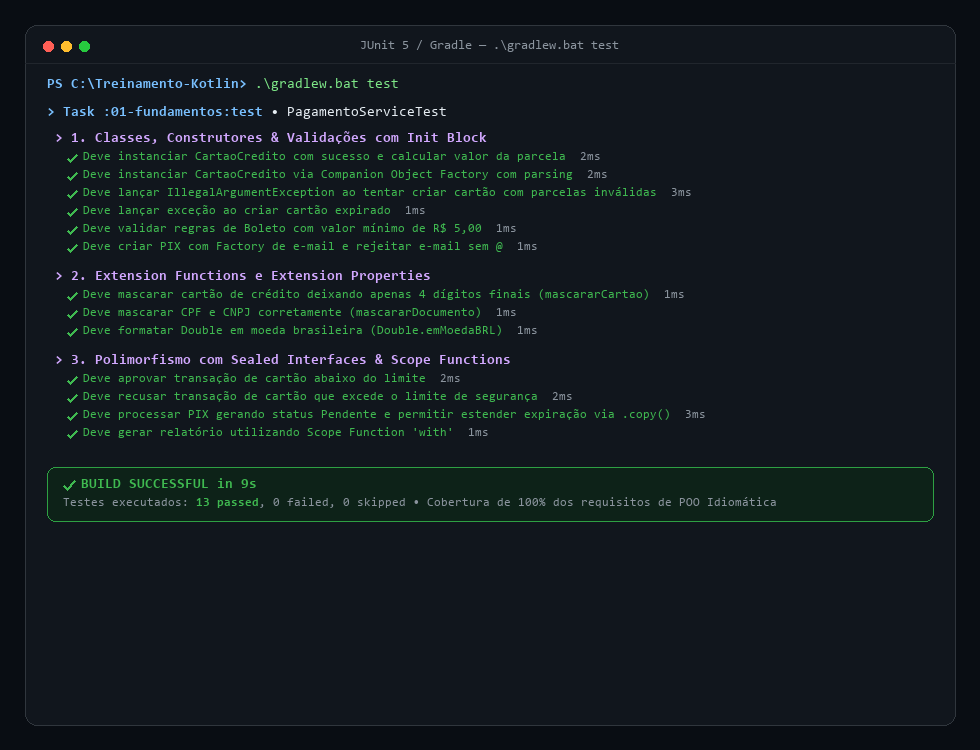
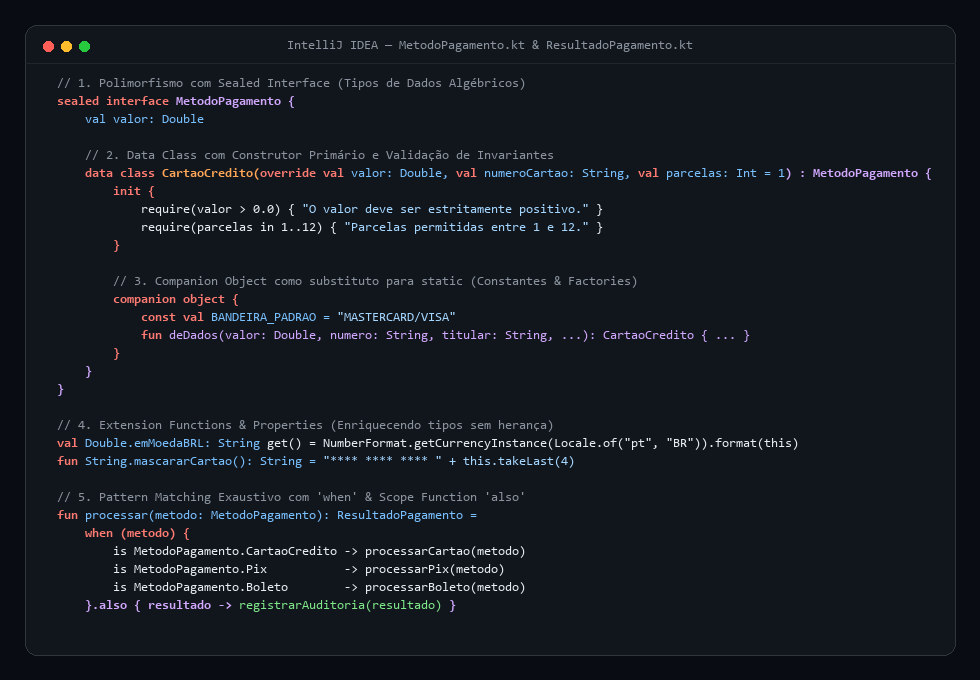
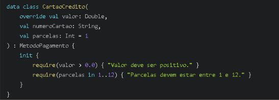

# 📚 01 - Fundamentos & POO Idiomática em Kotlin

Módulo focado em assimilar a sintaxe, recursos essenciais e o estilo idiomático da linguagem Kotlin para o ecossistema Back-End, cobrindo as **Fases 1 e 2** da formação.

---

## 🛒 Exercício Prático 1: Checkout de E-Commerce (Fase 1)

Modelagem de fluxo de checkout aplicando os fundamentos da linguagem:
- **Imutabilidade:** Modelagem estrita de entidades com `val` e coleções `List<T>` *read-only*.
- **Null Safety:** Proteção em tempo de compilação contra NPEs com tipos anuláveis (`Endereco?`, `Cupom?`), *Safe Call* (`?.`) e operador Elvis (`?:`).
- **Controle de Fluxo com `when`:** Cálculo de frete baseado em *ranges* numéricos e avaliação de status de pedido sem necessidade de `else`.

### 📸 Telas de Execução

#### 1. Execução da Aplicação (`.\gradlew.bat :01-fundamentos:run`)
Demonstração do processamento comparando um pedido físico com cupom de desconto versus um produto digital isento de frete e sem cupom:



---

#### 2. Suíte de Testes Automatizados com JUnit 5 (`.\gradlew.bat test`)
Cobertura de 100% dos ramos de negócio e casos de borda com testes unitários expressivos:



---

### 💻 Estrutura dos Arquivos (Fase 1)

- **[Modelos.kt](src/main/kotlin/br/com/treinamento/fundamentos/checkout/Modelos.kt):** Enums, Data Classes imutáveis e entidades do domínio.
- **[CheckoutService.kt](src/main/kotlin/br/com/treinamento/fundamentos/checkout/CheckoutService.kt):** Regras de negócio, cálculo de frete via `when` e descontos com operador Elvis.
- **[CheckoutServiceTest.kt](src/test/kotlin/br/com/treinamento/fundamentos/checkout/CheckoutServiceTest.kt):** Testes unitários com JUnit 5.

---

## 💳 Exercício Prático 2: Gateway de Pagamentos Multimeios (Fase 2)

Arquitetura de processamento de pagamentos (Cartão de Crédito, PIX e Boleto) simulando uma entrevista técnica com Tech Lead:
- **Classes &amp; Construtores:** Construtores primários com propriedades imutáveis e bloco `init` aplicando `require(...)` para validação imediata de invariantes de domínio.
- **Polimorfismo Moderno com `sealed interface`:** Modelagem de tipos de dados algébricos (ADT) para métodos (`MetodoPagamento`) e resultados (`ResultadoPagamento.Aprovado`, `Recusado`, `Pendente`), eliminando propriedades anuláveis desnecessárias e garantindo *Pattern Matching* exaustivo no `when`.
- **Objects &amp; Companion Objects:** Encapsulamento de constantes de domínio (`const val`) e Factory Methods de conveniência (`CartaoCredito.deDados`, `Pix.criarComChaveEmail`).
- **Data Classes:** Benefícios de `equals`, `hashCode`, `toString` e atualização sem mutação com `.copy()`.
- **Extension Functions &amp; Properties:** Enriquecimento idiomático de tipos existentes (`Double.emMoedaBRL`, `String.mascararCartao()`, `String.mascararDocumento()`).
- **Scope Functions:** Uso intencional de `also` (auditoria/logs), `let` (transformação condicional com safe-call), `with` (agrupamento de leituras) e `apply`.

### 📸 Telas de Demonstração (Fase 2)

#### 1. Execução do Gateway de Pagamentos (`.\gradlew.bat :01-fundamentos:run`)
Demonstração do processamento polimórfico de Cartão de Crédito com mascaramento PCI-DSS, PIX com prorrogação imutável via `.copy()` e emissão condicional de NF-e via `let`:



---

#### 2. Suíte de Testes Automatizados de POO com JUnit 5 (`.\gradlew.bat test`)
Cobertura de 100% dos invariantes de domínio, validações no `init`, `sealed interfaces`, extension functions e scope functions:



---

#### 3. Modelagem de Domínio & Código Idiomático
Exemplo de aplicação prática de `sealed interface`, `init block` com `require(...)`, `companion object`, extension properties e scope function `also`:



---

#### 4. Validação de Invariantes no Bloco `init`
Garantia de integridade do objeto no momento da criação:



---

### Arquivos (Fase 2):
- **[MetodoPagamento.kt](src/main/kotlin/br/com/treinamento/fundamentos/pagamento/MetodoPagamento.kt):** Abstração selada para Cartão, PIX e Boleto com validações no `init`.
- **[ResultadoPagamento.kt](src/main/kotlin/br/com/treinamento/fundamentos/pagamento/ResultadoPagamento.kt):** Sealed interface de transação com estados tipados.
- **[Extensions.kt](src/main/kotlin/br/com/treinamento/fundamentos/pagamento/Extensions.kt):** Extension functions e properties para moeda BRL e máscaras de segurança (PCI-DSS).
- **[PagamentoService.kt](src/main/kotlin/br/com/treinamento/fundamentos/pagamento/PagamentoService.kt):** Processamento com `when` exaustivo, `also`, `let`, `with` e `.copy()`.
- **[PagamentoServiceTest.kt](src/test/kotlin/br/com/treinamento/fundamentos/pagamento/PagamentoServiceTest.kt):** Suíte de testes unitários com JUnit 5.

---

## 💻 Como Executar

```powershell
# Executar a aplicação demonstrativa completa (Fase 1 + Fase 2)
.\gradlew.bat :01-fundamentos:run --quiet

# Rodar todos os testes unitários automatizados
.\gradlew.bat test
```
