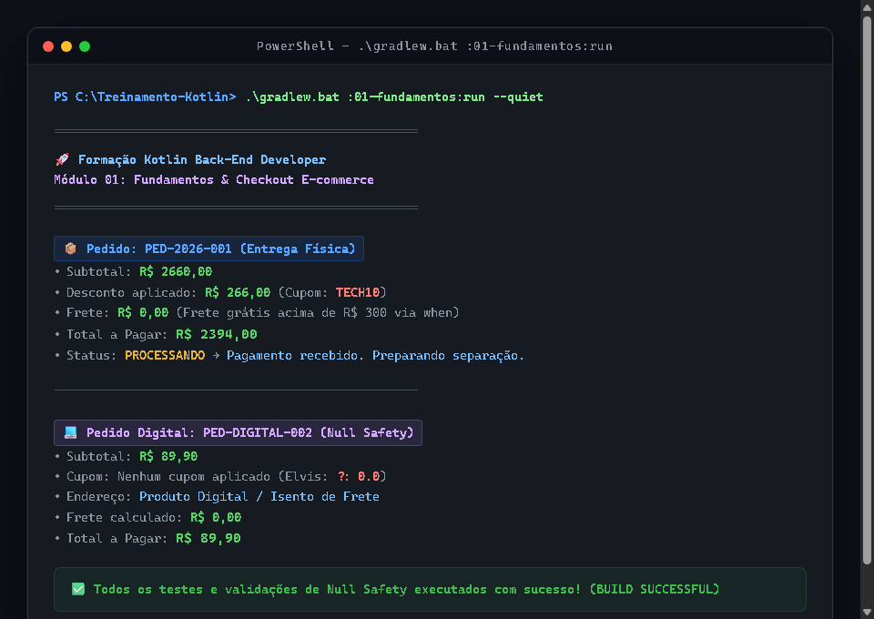
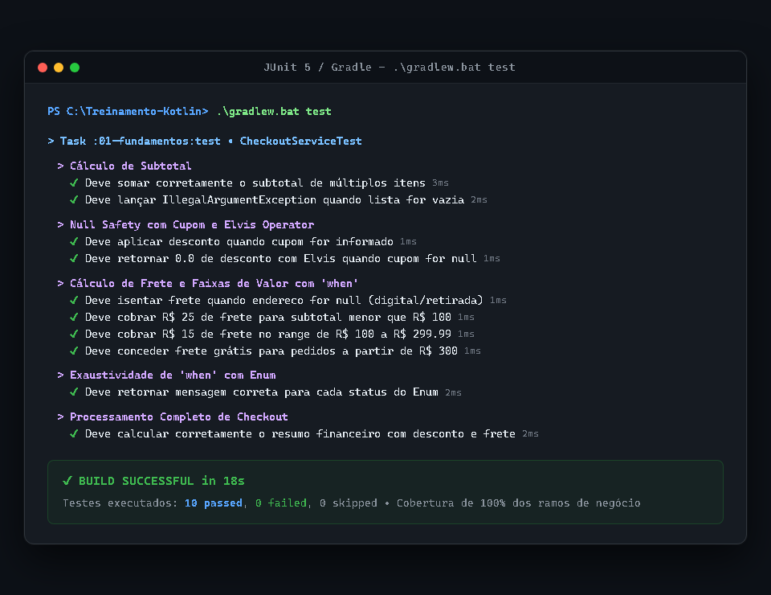

# 🚀 Formação Kotlin Back-End Developer

Repositório dedicado ao aprendizado prático, resolução de desafios e desenvolvimento de projetos da **Formação Kotlin Back-end Developer**.

---

## 🎯 Objetivo

Desenvolver proficiência sólida no ecossistema **Kotlin moderno para Back-end**, desde os fundamentos da linguagem e mentalidade idiomática até a construção de APIs RESTful robustas com **Spring Boot**, persistência com **Spring Data JPA** e testes automatizados com **MockK**.

---

## 📸 Demonstração Prática (Fase 1: Checkout E-commerce)

Exemplo de execução do primeiro exercício de fundamentos com Null Safety, Elvis Operator e faixas de frete calculadas com a expressão `when`:



### Bateria de Testes Unitários Automatizados (JUnit 5)



---

## 🛠️ Stack Tecnológica

- **Linguagem:** Kotlin 2.4+
- **Plataforma:** JVM (Java 25 LTS)
- **Framework:** Spring Boot 3.4+
- **Persistência:** Spring Data JPA / Hibernate & Flyway
- **Testes:** JUnit 5, MockK & AssertJ
- **Build Tool:** Gradle (Kotlin DSL)
- **Documentação de API:** SpringDoc OpenAPI / Swagger

---

## 📂 Estrutura do Repositório

```text
Treinamento-Kotlin/
├── README.md                     # Apresentação do projeto e portfólio
├── ROADMAP.md                    # Checklist e controle de progresso das fases de estudo
├── assets/screenshots/           # Screenshots e evidências de execução dos exercícios
├── 01-fundamentos/               # Conceitos essenciais da sintaxe, Null Safety e POO
│   └── README.md
├── 02-desafios-de-codigo/        # Resolução dos desafios práticos de código
│   └── README.md
└── 03-projetos/                  # Aplicações completas e APIs Spring Boot
    └── README.md
```

---

## 🗺️ Fases de Aprendizagem

Para detalhes completos de tópicos, tarefas e checklists de estudo, consulte o [ROADMAP.md](file:///c:/Users/Vaio/Documents/Jaques/Treinamento-Kotlin/ROADMAP.md).

1. **Fase 1: Fundamentos & Mentalidade Kotlin** (Imutabilidade, Null Safety, Expressões de Controle)
2. **Fase 2: POO Idiomática & Recursos Avançados** (Data Classes, Sealed Classes, Extensions, Scope Functions)
3. **Fase 3: Paradigma Funcional & Coleções** (Lambdas, HOFs, Streams e Sequences)
4. **Fase 4: Back-end Moderno com Spring Boot** (Controllers, DTOs, Services, JPA, Exception Handling)
5. **Fase 5: Testes Unitários & Qualidade de Software** (MockK, JUnit 5, MockMvc)

---

## 💻 Como Executar

```powershell
# Executar a aplicação de exercícios
.\gradlew.bat :01-fundamentos:run --quiet

# Rodar a suíte completa de testes unitários
.\gradlew.bat test
```
